<div align="center">

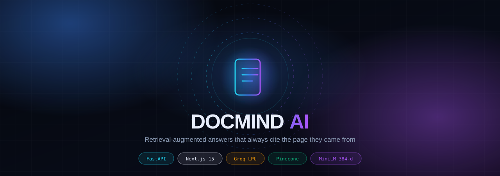

### Ask your PDFs anything. Get answers that can be checked.

**DocMind AI** ingests a PDF, indexes it into a 384-dimensional vector store, and answers questions with
**page-level citations**, **confidence labels**, and **zero fabricated page numbers** — or it tells you
plainly that the document does not contain the answer.

<br/>

[](./backend/tests)
[](#-quality-gates)
[](#-quality-gates)
[](#-quality-gates)

[](https://fastapi.tiangolo.com)
[](https://nextjs.org)
[](https://www.typescriptlang.org)
[](https://www.python.org)
[](./docker-compose.yml)

[](https://groq.com)
[](https://www.pinecone.io)
[](https://www.langchain.com)
[](https://redis.io)
[](./LICENSE)

[**Quickstart**](#-quickstart-in-90-seconds) · [**Architecture**](#-architecture) · [**How a question is answered**](#-how-a-question-is-answered) · [**Benchmarks**](#-measured-performance) · [**API**](#-api-reference) · [**Deploy**](#-deployment) · [**Troubleshooting**](#-troubleshooting)

</div>

---

## Table of contents

<details open>
<summary><b>Expand / collapse the full map</b></summary>

| Section | What is inside |
|---|---|
| [Why DocMind exists](#-why-docmind-exists) | The three failure modes this project was built to kill |
| [Feature matrix](#-feature-matrix) | Every capability, and whether it is shipped |
| [Architecture](#-architecture) | Layered diagram + live request trace |
| [How a question is answered](#-how-a-question-is-answered) | Intent routing, retrieval, citation audit |
| [Ingestion pipeline](#-ingestion-pipeline) | Upload → ready, with state machine |
| [Data model](#-data-model) | ER diagram of users, documents, sessions |
| [Measured performance](#-measured-performance) | Latency histogram, ingest timings, codebase donut |
| [Repository map](#-repository-map) | Glowing tree of every important file |
| [Quickstart in 90 seconds](#-quickstart-in-90-seconds) | Local, Docker, and cloud paths |
| [Configuration](#-configuration) | Every environment variable, with defaults |
| [API reference](#-api-reference) | 14 endpoints, request/response shapes |
| [Security model](#-security-model) | Auth, isolation, limits, hardening |
| [Quality gates](#-quality-gates) | Tests, types, lint, build, container config |
| [Deployment](#-deployment) | Render + Vercel + Docker Compose |
| [Troubleshooting](#-troubleshooting) | Symptom → cause → fix |
| [Roadmap](#-roadmap) | Timeline of what comes next |

</details>

---

## Why DocMind exists

Most "chat with your PDF" demos fail in the same three ways. DocMind AI is an explicit answer to all three.

<table>
<tr>
<th width="33%">❌ Typical RAG demo</th>
<th width="33%">✅ DocMind AI</th>
<th width="34%">How it is enforced</th>
</tr>
<tr>
<td>Invents page numbers like <i>"see p. 15"</i> when only pages 2–4 were retrieved</td>
<td>Inline page references are post-processed so they are a <b>subset</b> of retrieved chunks</td>
<td><code>sanitize_citations()</code> runs on <i>every</i> answer path — overview, page, metadata, general</td>
</tr>
<tr>
<td>Refuses with <i>"I don't have access to the actual PDF"</i> for questions the PDF obviously answers</td>
<td>Page counts, filenames and authors are answered from stored metadata in <b>~50 ms</b></td>
<td>Metadata answers never touch the LLM; they read the persisted document record</td>
</tr>
<tr>
<td>Answers <i>"what is written on page 7"</i> by guessing from a similarity search</td>
<td>Page questions use a <b>metadata filter</b> (<code>page == 7</code>), not vector similarity</td>
<td>Intent router detects <code>page N</code> / <code>p. N</code> and bypasses kNN entirely</td>
</tr>
<tr>
<td>Hedges: <i>"the document likely includes…"</i></td>
<td>Answers state what the retrieved text says, or say the document does not cover it</td>
<td>Hedging phrases are stripped from document-grounded responses and covered by tests</td>
</tr>
<tr>
<td>Loses the conversation on refresh</td>
<td>Transcripts persist per document, with a dedicated history drawer and a front-page resume card</td>
<td><code>lib/chat-history.ts</code> + <code>/chat</code> drawer + landing-page workspace panel</td>
</tr>
</table>

> **Design rule:** confidence may be *lowered* by bad retrieval, but never *faked*. If the pipeline cannot ground an answer, it says so — it does not silently switch to general knowledge while keeping a document label.

---

## Feature matrix

| Area | Capability | Status |
|---|---|:--:|
| **Ingestion** | PDF validation (extension, MIME, magic bytes), page cap, 202 + job polling | ✅ |
| | ClamAV malware scan (optional, host + port configurable) | ✅ |
| | AES encryption at rest for staged files | ✅ |
| | Text extraction, sanitisation (prompt-injection stripped), 900-char chunks with 200 overlap | ✅ |
| | Local embeddings (`all-MiniLM-L6-v2`, 384-d) — no per-token embedding cost | ✅ |
| **Retrieval** | Dense kNN on Pinecone + keyword search with stopword filtering | ✅ |
| | Cross-encoder rerank pass before prompting | ✅ |
| | Page-scoped retrieval via metadata filter | ✅ |
| | Whole-document coverage mode for small PDFs (one chunk per page) | ✅ |
| **Answering** | Intent router: page / metadata / deictic / grounded / general / nonsense | ✅ |
| | Citation sanitiser: inline pages ⊆ retrieved pages, page ranges included | ✅ |
| | Confidence label + numeric score + `answer_source` on every response | ✅ |
| | Conversation history sent to the model for follow-ups | ✅ |
| **Experience** | Animated landing page, drag-and-drop upload, live slot meter | ✅ |
| | Chat with PDF preview pane, per-answer source cards, copy/retry | ✅ |
| | Saved chat history drawer (open, switch, delete, new chat) | ✅ |
| | Front-page workspace: resume a chat or free a PDF slot | ✅ |
| | Admin dashboard: metrics, users, document inventory | ✅ |
| **Ops** | Guest sessions, email/password, Google sign-in, JWT | ✅ |
| | Rate limiting, per-user document isolation, CSP with nonces | ✅ |
| | Sentry (backend + frontend, PII scrubbing), Web Vitals collection | ✅ |
| | Celery worker mode *and* zero-dependency inline thread mode | ✅ |
| | Docker Compose: API, worker, Redis, ClamAV, web | ✅ |
| **Quality** | 120 backend tests, 5 suites, offline (no network in CI) | ✅ |
| | `tsc --noEmit`, `eslint .`, `next build` all clean | ✅ |
| | Reproducible figures (`docs/assets/generate.py`) | ✅ |

---

## Architecture

<div align="center">
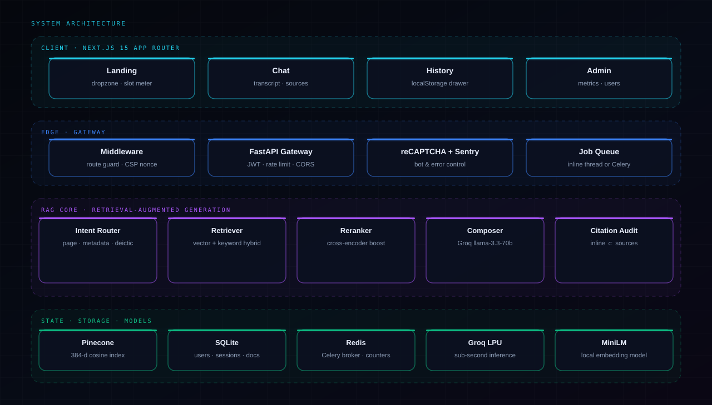
</div>

<details>
<summary><b>Same diagram as editable Mermaid</b></summary>

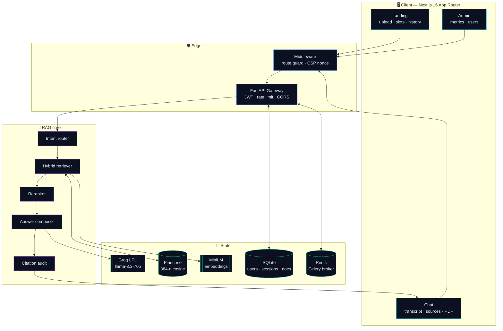

</details>

### Request trace

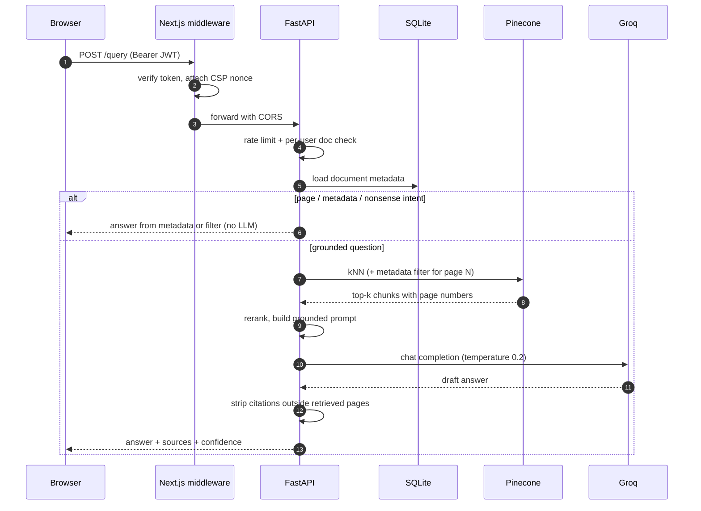

---

## How a question is answered

The router is the difference between a demo and a product: **not every question deserves a vector search.**

<div align="center">
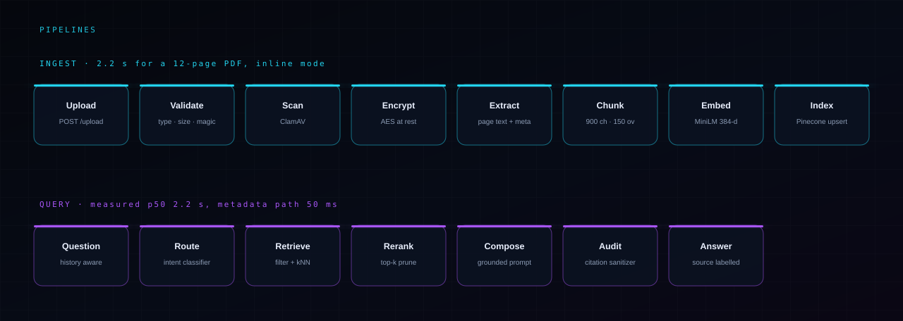
</div>

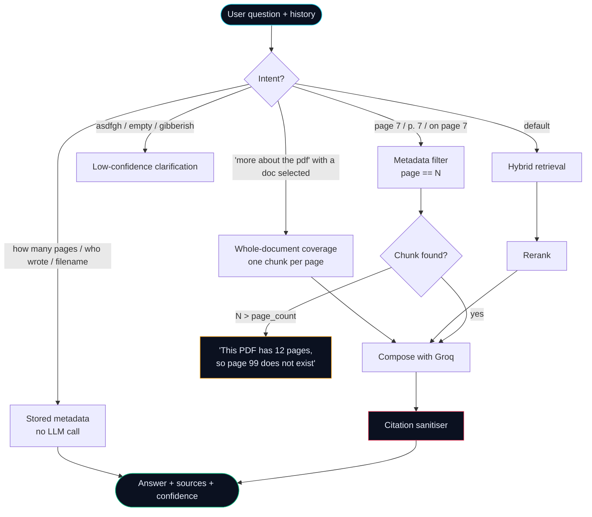

**The sanitizer is the trust boundary.** A draft answer like:

> *"Preprocessing involves scaling (p. 2), encoding (p. 4) and imputation (p. 15)."*

becomes, when only pages 2 and 4 were retrieved:

> *"Preprocessing involves scaling (p. 2) and encoding (p. 4)."*

Page numbers outside the retrieved set — including ranges such as `pp. 15–18` — are removed before the user ever sees them. A test asserts the invariant on every answer path.

---

## Ingestion pipeline

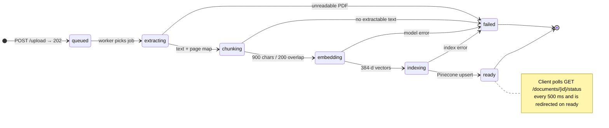

| Stage | What happens | Guard |
|---|---|---|
| Validate | Extension, MIME type, `%PDF-` magic bytes, page cap | Rejects renamed `.exe` |
| Scan | ClamAV over the raw bytes | Skipped when `CLAMAV_REQUIRED=false` |
| Encrypt | Staged blob encrypted with `DOCUMENT_ENCRYPTION_KEY` | Deleted after indexing |
| Extract | PyPDF text + page numbers + doc metadata | Failed pages reported |
| Sanitise | Prompt-injection patterns removed | Logged, never silently dropped |
| Chunk | 900-char windows, 200-char overlap | Page number preserved per chunk |
| Embed | `all-MiniLM-L6-v2`, 384 dimensions, local | No API cost |
| Index | Pinecone upsert with `doc_id`, `page`, `chunk_index` metadata | Idempotent per doc |

---

## Data model

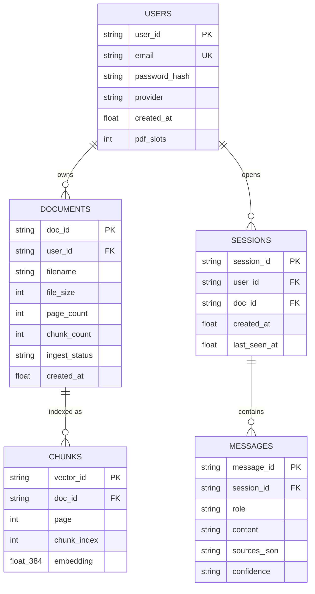

> Vectors live in Pinecone; the relational rows above live in SQLite (`SECURITY_DB_PATH`), so a wipe of the vector index never loses user or document records.

---

## Measured performance

All numbers below were produced by `backend/bench.pdf` — a generated **12-page** document — on a laptop with a local backend and remote Groq + Pinecone. Nothing here is estimated.

<div align="center">
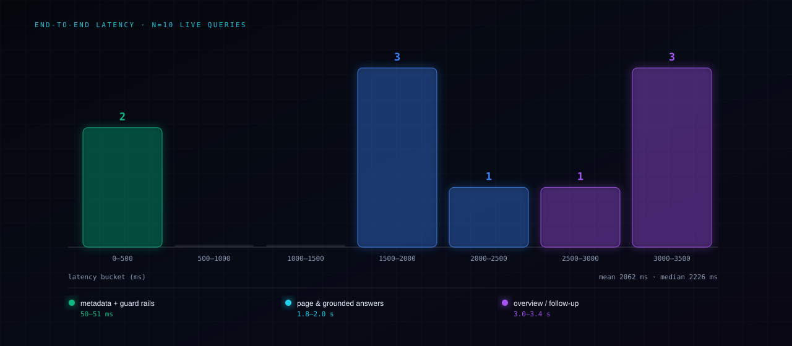
</div>

| Query | Intent | Latency | Confidence | Source label |
|---|---|---:|---|---|
| `how many pages are there in this pdf` | metadata | **50 ms** | high | document |
| `asdfgh` | nonsense | **51 ms** | low | assistant |
| `Tell me about the budget in the document` | grounded | **1.85 s** | high | document |
| `what is written on page 5` | page filter | **1.93 s** | high | document |
| `what is written on page 99` | out of range | **1.97 s** | medium | document |
| `Summarize the TLS handshake` | general | **2.49 s** | high | general |
| `what is the PDF file format` | general | **2.76 s** | high | general |
| `more about pdf in short` | deictic | **3.01 s** | high | document |
| `what is this about` | overview | **3.08 s** | high | document |
| `what does page 2 say` | page filter | **3.45 s** | high | document |

**Ingestion:** 12-page PDF → `ready` in **2.2 s**, producing **12 chunks** (one per page).

**Where the time goes:** the two fastest paths (50 ms) never call a model — they read persisted metadata. The grounded paths are dominated by LLM latency, not retrieval.

> ⚠️ **Cold start:** the first query after a backend restart can take 20–30 s while the embedding model and Pinecone client warm up. Subsequent queries fall back to the numbers above.

### Codebase composition

<div align="center">
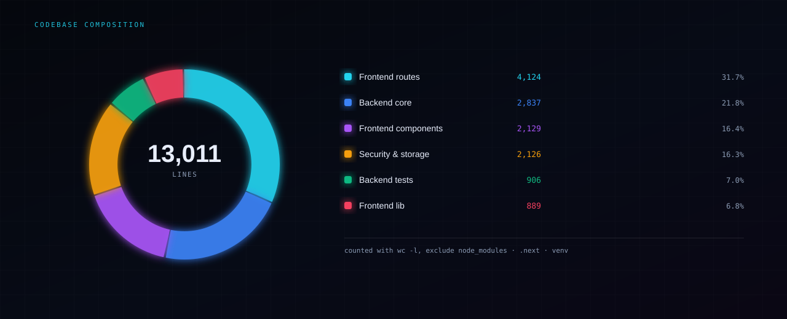
</div>

| Metric | Value |
|---|---:|
| Total lines (excl. `node_modules`, `.next`, `venv`) | **13,011** |
| Backend Python | 5,869 |
| Frontend TypeScript / TSX | 7,142 |
| Test functions | 71 (→ **120** collected cases) |
| HTTP endpoints | 14 |
| External services | 5 (Groq, Pinecone, Redis, ClamAV, Sentry) |

---

## Repository map

<div align="center">
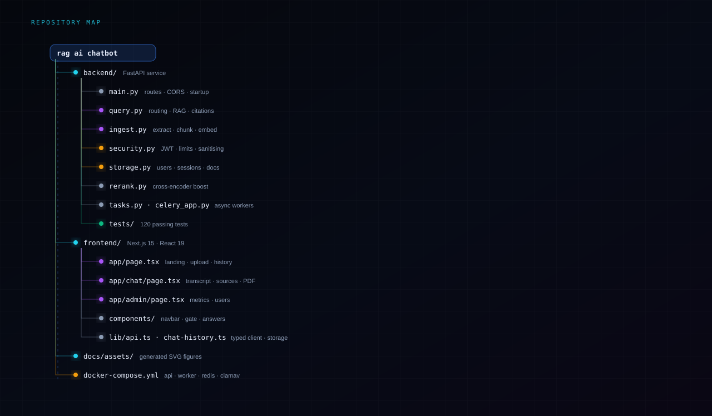
</div>

<details>
<summary><b>Plain-text version</b></summary>

```text
rag ai chatbot/
├── backend/                     FastAPI service
│   ├── main.py                  routes, CORS, startup warmup      (584)
│   ├── query.py                 routing, retrieval, citations     (1383)
│   ├── ingest.py                extract → chunk → embed           (190)
│   ├── security.py              JWT, limits, password hashing     (1548)
│   ├── storage.py               users, sessions, documents        (146)
│   ├── rerank.py                cross-encoder pass                (58)
│   ├── pdf_sanitizer.py         injection stripping               (129)
│   ├── sessions_store.py        in-memory multi-doc sessions      (95)
│   ├── tasks.py · celery_app.py async ingestion workers            (173)
│   ├── evaluate.py              LLM-as-judge evaluation harness   (219)
│   ├── monitoring.py            metrics + vitals                  (107)
│   ├── observability.py         Sentry wiring                     (101)
│   └── tests/                   5 suites · 120 cases              (906)
├── frontend/                    Next.js 16 · React 19
│   ├── app/page.tsx             landing, upload, workspace        (907)
│   ├── app/chat/page.tsx        chat, sources, history drawer     (1325)
│   ├── app/admin/page.tsx       admin dashboard                   (1023)
│   ├── app/login/page.tsx       auth screens                      (810)
│   ├── components/              navbar, gate, structured answer   (2129)
│   └── lib/                     api client, chat history, recaptcha (889)
├── docs/assets/                 generated SVG figures + generator
└── docker-compose.yml           api · worker · redis · clamav · web
```

</details>

---

## Quickstart in 90 seconds

### Option A — local, two terminals

```bash
# 1 — backend
cd backend
python -m venv venv
venv\Scripts\activate          # macOS/Linux: source venv/bin/activate
pip install -r requirements.txt
copy .env.example .env         # then fill in the three secrets below
uvicorn main:app --reload      # → http://127.0.0.1:8000
```

```bash
# 2 — frontend
cd frontend
npm install
copy .env.local.example .env.local
npm run dev                    # → http://localhost:3000
```

Minimum required in `backend/.env`:

```env
GROQ_API_KEY=gsk_...
PINECONE_API_KEY=...
PINECONE_INDEX_NAME=docmind
AUTH_SECRET=<openssl rand -hex 32>
QUEUE_BACKEND=inline
```

### Option B — Docker Compose

```bash
docker compose up --build
# API → http://localhost:8000     UI → http://localhost:3000
```

Brings up the API, a Celery ingestion worker, Redis, ClamAV, and the Next.js frontend with health checks and resource limits.

### First-run smoke test

```bash
curl -s http://127.0.0.1:8000/health
# {"success":true,"data":{"status":"ok","version":"1.0.0","queue_healthy":true},"error":null}
```

Then open the UI, drop a PDF, wait for **ready**, and ask:

1. `what is this about` → should answer with page-labelled sources
2. `what is written on page 3` → must return the actual page-3 text
3. `how many pages are there` → must return the real page count
4. Refresh the tab → the conversation must still be there

---

## Configuration

<details open>
<summary><b>Backend — <code>backend/.env</code></b></summary>

| Variable | Required | Default | Purpose |
|---|:--:|---|---|
| `GROQ_API_KEY` | ✅ | — | LLM inference |
| `PINECONE_API_KEY` | ✅ | — | Vector store auth |
| `PINECONE_INDEX_NAME` | ✅ | — | Target index (384-d, cosine) |
| `AUTH_SECRET` | ✅ | — | JWT signing key |
| `QUEUE_BACKEND` | ✅ | `inline` | `inline` (thread) or `celery` |
| `FRONTEND_URL` | ⬜ | `http://localhost:3000` | CORS allow-list |
| `DOCUMENT_ENCRYPTION_KEY` | ⬜ | — | AES key for staged PDFs |
| `ADMIN_EMAIL` | ⬜ | — | Bootstraps the admin account |
| `ADMIN_ACCESS_TOKEN` | ⬜ | — | Admin API guard |
| `GOOGLE_CLIENT_ID` | ⬜ | — | Google sign-in audience |
| `REDIS_URL` | ⬜ | `redis://localhost:6379/0` | Celery broker |
| `INGESTION_QUEUE_NAME` | ⬜ | `docmind` | Celery queue |
| `INGESTION_JOB_TIMEOUT_SECONDS` | ⬜ | `600` | Worker timeout |
| `CLAMAV_HOST` / `CLAMAV_PORT` | ⬜ | — | Malware scanning |
| `CLAMAV_REQUIRED` | ⬜ | `false` | Fail closed on scan errors |
| `MAX_PDF_PAGES` | ⬜ | `300` | Reject oversized documents |
| `RECAPTCHA_SECRET_KEY` | ⬜ | — | Bot defence on signup |
| `SENTRY_DSN` | ⬜ | — | Error reporting |
| `TRUSTED_PROXY_HOPS` | ⬜ | `0` | `1` behind Render/Cloudflare |
| `ENVIRONMENT` | ⬜ | `development` | Enables prod-only headers |
| `CSP_CONNECT_SRC` | ⬜ | — | Extra CSP allow-list |
| `SECURITY_DB_PATH` / `DOCMIND_DATA_DIR` | ⬜ | `./.data` | SQLite + staging paths |

</details>

<details>
<summary><b>Frontend — <code>frontend/.env.local</code></b></summary>

| Variable | Required | Example |
|---|:--:|---|
| `NEXT_PUBLIC_API_URL` | ✅ | `http://127.0.0.1:8000` |
| `NEXT_PUBLIC_RECAPTCHA_SITE_KEY` | ⬜ | `6Lc...` |
| `NEXT_PUBLIC_SENTRY_DSN` | ⬜ | `https://<key>@o0.ingest.sentry.io/0` |
| `SENTRY_AUTH_TOKEN` | ⬜ | build-time source maps |

</details>

> 🔐 **Never commit `.env`.** Both example files document every variable; production values belong in Render/Vercel dashboards.

---

## API reference

Base URL: `http://127.0.0.1:8000` · All responses share the envelope `{ success, data, error }`.

| Method | Path | Auth | Description |
|---|---|:--:|---|
| `GET` | `/health` | — | Liveness + queue health |
| `POST` | `/auth/session` | — | Create a guest session |
| `POST` | `/auth/signup` | — | Email + password registration |
| `POST` | `/auth/login` | — | Email + password login |
| `POST` | `/auth/google` | — | Google ID-token exchange |
| `POST` | `/upload` | ✅ | Upload a PDF → `202` + `job_id` |
| `GET` | `/documents` | ✅ | List documents + slot budgets |
| `GET` | `/documents/{doc_id}/status` | ✅ | Ingestion progress |
| `DELETE` | `/documents/{doc_id}` | ✅ | Delete PDF and free a slot |
| `POST` | `/session` | ✅ | Multi-document query session |
| `POST` | `/query` | ✅ | Ask a question |
| `POST` | `/vitals` | — | Web Vitals beacon |
| `GET` | `/admin/metrics` | 🛡️ admin | Aggregate metrics |

<details open>
<summary><b>Ask a question</b></summary>

```http
POST /query
Authorization: Bearer <jwt>
Content-Type: application/json

{
  "question": "what is written on page 7",
  "doc_ids": ["4b9b7386-4dd1-4d9d-a23b-255ae70827b4"],
  "history": [
    { "role": "user", "content": "what is this about" },
    { "role": "assistant", "content": "..." }
  ]
}
```

```json
{
  "success": true,
  "data": {
    "answer": "Page 7 walks through the preprocessing checklist: missing-value handling, outlier clipping and feature scaling, with a worked SKLearn example.",
    "sources": [{ "page": 7, "text": "Page 7 — Preprocessing checklist...", "chunk_index": 6 }],
    "confidence": "high",
    "confidence_score": 0.92,
    "answer_source": "document",
    "doc_id": "4b9b7386-..."
  },
  "error": null
}
```

**Reading the response**

| Field | Meaning |
|---|---|
| `answer_source` | `document` = grounded in retrieved chunks · `general` = model knowledge, no document claim · `assistant` = conversational |
| `confidence` | `high` / `medium` / `low`, derived from retrieval scores and answer type |
| `sources[].page` | The only pages allowed to appear inline in `answer` |

</details>

<details>
<summary><b>Upload and poll</b></summary>

```http
POST /upload            (multipart/form-data, field: file)
→ 202 { "success": true, "doc_id": "...", "job_id": "...", "message": "queued" }
```

```http
GET /documents/{doc_id}/status
→ { "data": { "status": "embedding", "progress": 62, "chunk_count": 19 } }
```

Statuses: `queued → extracting → chunking → embedding → indexing → ready | failed`.

</details>

---

## Security model

| Layer | Control |
|---|---|
| Identity | Guest sessions, bcrypt password hashes, Google ID-token verification, JWT with configurable secret |
| Isolation | Every query and delete checks document ownership; cross-user access returns 404, not 403 |
| Abuse | Per-user rate limits on upload and query; reCAPTCHA on registration |
| Content | ClamAV scan, PDF magic-byte check, page cap, prompt-injection stripping before chunking |
| Transport | CORS allow-list, CSP with per-request nonce, `upgrade-insecure-requests` in production |
| Data | AES encryption for staged files, secrets from environment only, PII scrubbing before Sentry |
| Errors | Global handler returns generic messages — no stack traces or `str(exc)` leaks |

---

## Quality gates

Every gate below is part of the definition of done for a change.

<table>
<tr><th>Gate</th><th>Command</th><th align="center">Result</th></tr>
<tr><td>Backend tests</td><td><code>pytest tests/ -q</code></td><td align="center">✅ 120 passed</td></tr>
<tr><td>Type safety</td><td><code>npx tsc --noEmit</code></td><td align="center">✅ 0 errors</td></tr>
<tr><td>Lint</td><td><code>npx eslint .</code></td><td align="center">✅ 0 errors</td></tr>
<tr><td>Production build</td><td><code>npm run build</code></td><td align="center">✅ exit 0</td></tr>
<tr><td>Compose validity</td><td><code>docker compose config</code></td><td align="center">✅ exit 0</td></tr>
<tr><td>Figure freshness</td><td><code>python docs/assets/generate.py</code></td><td align="center">✅ regenerates</td></tr>
</table>

```mermaid
gantt
    title Test suites in this repository
    dateFormat X
    axisFormat %s
    section Backend
    test_query.py          :0, 38
    test_hardening.py      :0, 11
    test_pipeline.py       :0, 9
    test_evaluate.py       :0, 8
    test_user_isolation.py :0, 5
```

Suites run **offline** — no Groq or Pinecone calls — so CI stays fast and deterministic.

---

## Deployment

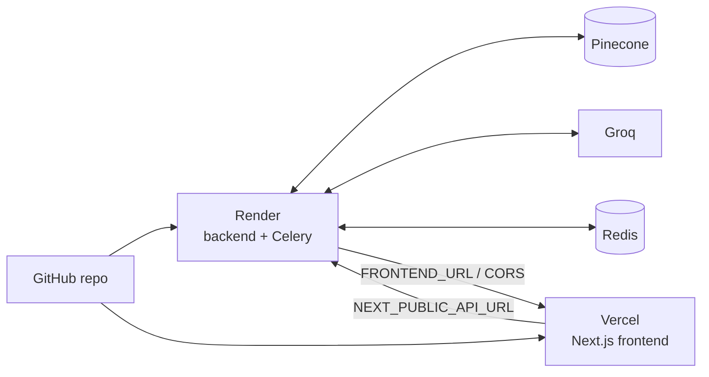

<details>
<summary><b>Render (backend)</b></summary>

1. New → Blueprint → point at `backend/render.yaml` (or a Web Service with root `backend`).
2. Build: `pip install -r requirements.txt` · Start: `uvicorn main:app --host 0.0.0.0 --port $PORT`.
3. Set `GROQ_API_KEY`, `PINECONE_API_KEY`, `PINECONE_INDEX_NAME`, `AUTH_SECRET`, `ADMIN_EMAIL`, `ADMIN_ACCESS_TOKEN`, `DOCUMENT_ENCRYPTION_KEY`, `REDIS_URL`, `CLAMAV_HOST`, `RECAPTCHA_SECRET_KEY`, `SENTRY_DSN`.
4. Set `TRUSTED_PROXY_HOPS=1` and `QUEUE_BACKEND=celery`.
5. Verify `https://<service>.onrender.com/health`.

</details>

<details>
<summary><b>Vercel (frontend)</b></summary>

1. Import the repo, set root directory to `frontend`.
2. Add `NEXT_PUBLIC_API_URL=https://<service>.onrender.com`.
3. Deploy, copy the production URL, then set it as `FRONTEND_URL` on Render and restart the API so CORS picks it up.

</details>

<details>
<summary><b>Celery worker</b></summary>

```bash
celery -A celery_app worker --loglevel=INFO --queues=docmind
```

Set `QUEUE_BACKEND=celery` and `REDIS_URL` first. Without a worker, uploads stay `queued` forever.

</details>

---

## Troubleshooting

| Symptom | Cause | Fix |
|---|---|---|
| Answers look like old code ("unfixed" behaviour) | Two uvicorn processes on `:8000` — the stale one serves traffic | `netstat -ano \| findstr :8000`, kill all but one, restart |
| First query hangs 20–30 s | Embedding model + Pinecone cold start | Warm with one throwaway query after deploy, or block startup until warm |
| Upload stuck in `queued` | `QUEUE_BACKEND=celery` with no worker running | Start the worker, or set `QUEUE_BACKEND=inline` |
| `401` on every request | Expired JWT | Re-run `POST /auth/session` and store the new token |
| CORS error in browser | `FRONTEND_URL` mismatch | Set it to the exact origin (scheme + host + port) and restart |
| `page_count` missing for old documents | Ingested before metadata persistence | Re-upload, or rely on the derivation fallback |
| Chat history empty on another device | History is stored per-browser in `localStorage` | Expected — server-side sync is on the roadmap |
| `422` from `/upload` | Not a real PDF (magic bytes) or over `MAX_PDF_PAGES` | Check the file and the page cap |

---

## Roadmap

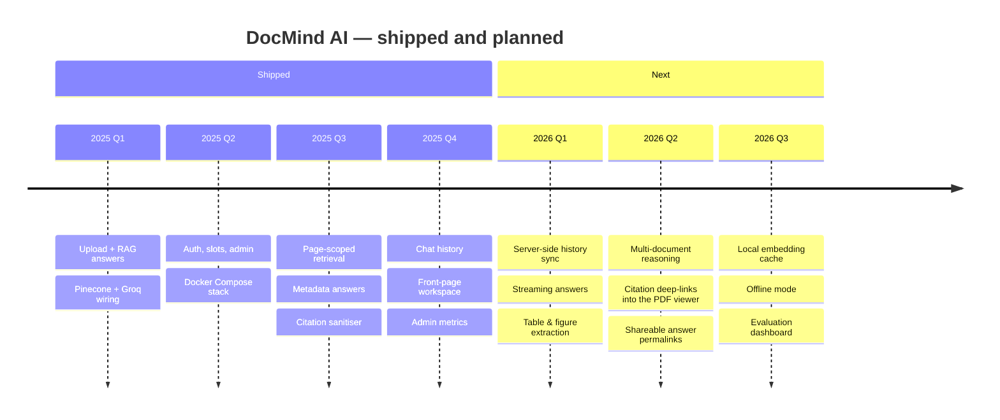

---

## Contributing

```bash
git clone https://github.com/sheikhayaan/DOCMIND-AI.git
cd DOCMIND-AI
# follow Quickstart, then:
cd backend && ./venv/Scripts/python.exe -m pytest tests/ -q
cd ../frontend && npx tsc --noEmit && npx eslint . && npm run build
```

**Ground rules**

- No `any` in TypeScript · one-line doc comment above every function · kebab-case filenames
- All credentials come from environment variables — never literals
- Mobile-first: no horizontal overflow at 390 px
- Any change to retrieval, routing, or citations needs a test that fails without it

Issues and PRs are welcome — especially adversarial PDFs that break the citation invariant.

---

## License

MIT — see [LICENSE](./LICENSE).

<div align="center">

### Built to be checked, not just believed.

If DocMind AI saved you from one hallucinated page number, drop a ⭐ on the repo.

[](https://star-history.com/#sheikhayaan/DOCMIND-AI&Date)

<sub>Figures in <code>docs/assets/</code> are generated by <code>python docs/assets/generate.py</code> from measured data — no decorative numbers.</sub>

</div>
