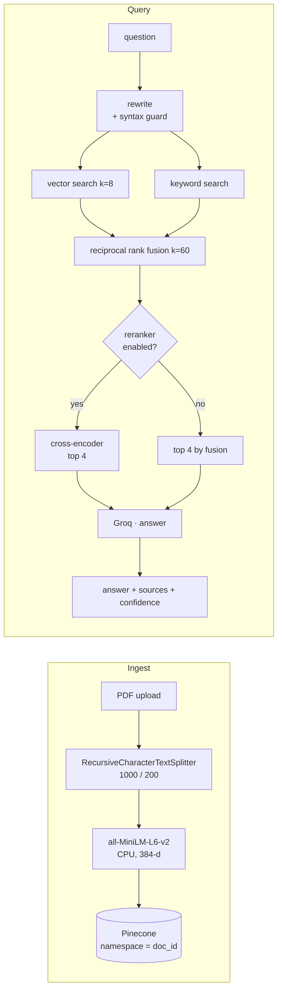

# DocMind AI

**Ask a question about a PDF and get an answer you can check — with the passage it came from.**

Upload a document, ask in plain language, and read the answer next to the retrieved
chunks that produced it. Retrieval is hybrid (vector + keyword, fused), the reranker
is optional, and the system prompt is allowed exactly one escape hatch:
*"I could not find this information in the document."*

`Next.js` `TypeScript` `FastAPI` `LangChain` `Pinecone` `Groq`

**[Live demo →](https://docmind-ai-dusky.vercel.app)**

---

## Why this exists

A long document plus a chatbot that guesses is worse than no chatbot, because a
fluent wrong answer costs more time than reading the section yourself. So the design
goal was not "answer more questions" — it was "never answer a question the document
doesn't answer, and make every answer auditable in one glance".

## Architecture



**Request path.** `POST /upload` extracts and chunks the PDF, embeds it locally, and
upserts into a Pinecone namespace named after the document id. `POST /session` binds a
chat session to one or more document ids. `POST /query` rewrites the question, runs
vector and keyword retrieval in parallel, fuses the ranked lists with
reciprocal-rank fusion, optionally reranks the head of that list with a cross-encoder,
and generates from four chunks.

## Design decisions

1. **Local embeddings, not a hosted embedding API.** `all-MiniLM-L6-v2` on CPU costs
   nothing per document, keeps ingestion working when the chat provider is down, and
   removes a second vendor from the critical path. The trade-off is 384 dimensions
   instead of 1536 — for single-document retrieval that was the right side of the deal.
2. **Hybrid retrieval, because one retriever is always wrong somewhere.** Vector search
   misses exact identifiers (`RFC 9110`, `HX711`, section numbers); keyword search
   misses paraphrase. Reciprocal-rank fusion needs no score calibration between the
   two, which is why it is used instead of a weighted sum.
3. **The reranker is opt-in.** A cross-encoder measurably improves the top of the list
   and adds a model download plus roughly a second of latency. `ENABLE_RERANKER`
   defaults to off, and when it is off the fusion order is preserved rather than
   silently re-sorted.
4. **The rewrite step is guarded.** Asking a model to rewrite a question into a search
   query invites it to emit SQL or Boolean syntax that the retriever cannot use.
   `is_invalid_rewrite()` rejects that output and falls back to the original question.
5. **Citation over confidence.** Answers carry the retrieved chunks and a confidence
   band derived from similarity scores; the UI shows both. A user who can see the
   source does not need to trust the model.
6. **Evaluation is part of the repo.** `backend/evaluate.py` scores retrieval and answer
   quality with a judge model over a case set, so a retrieval change is measured, not
   argued about.

## Project layout

```
backend/    FastAPI: main.py (routes) · ingest.py (chunk/embed/upsert)
            query.py (rewrite → hybrid → RRF → rerank → generate)
            rerank.py (optional cross-encoder) · evaluate.py · observability.py
            tests/ (pipeline, query, evaluate)
frontend/   Next.js App Router: chat UI, streaming, source cards
```

## Quick start

```bash
# backend
cd backend
python -m venv .venv && source .venv/bin/activate   # Windows: .venv\Scripts\activate
pip install -r requirements.txt
cp .env.example .env      # GROQ_API_KEY, PINECONE_API_KEY, PINECONE_INDEX_NAME, FRONTEND_URL
uvicorn main:app --reload --port 8000

# frontend
cd frontend
npm install
# point the client at the API (see frontend/lib/api.ts); default is :8000
npm run dev                        # http://localhost:3000
```

Optional: `ENABLE_RERANKER=true` turns on the cross-encoder path (downloads
`cross-encoder/ms-marco-MiniLM-L-6-v2` on first use).

## Tests

```bash
cd backend && pytest -q          # pipeline, query, evaluation harness
cd frontend && npm run lint
```

CI runs the backend suite on every push.

## Limits

- **One document at a time, in practice.** Sessions accept several ids, but the
  retrieval tuning (`k=8`, top 4) is calibrated for a single PDF, not a corpus.
- **Pinecone is a hard dependency for ingest.** No local fallback vector store ships.
- **Metadata lives in process memory.** `DOC_METADATA` is a module-level dict, so a
  restart loses filename/page mapping for previously ingested documents.
- **Free-tier hosting sleeps.** The Vercel frontend is always warm; the API is not, so
  the first query after idle can take several seconds.

## Deploy

Backend: `backend/render.yaml` (Render) or the included `Dockerfile`.
Frontend: `frontend/vercel.json`, with `NEXT_PUBLIC_API_URL` pointed at the API origin
and `FRONTEND_URL` set on the backend for CORS.

## Author

**Mohd Ayaan** — [github.com/sheikhayaan](https://github.com/sheikhayaan) ·
[LinkedIn](https://linkedin.com/in/mohd-ayaan-7731b4381)
